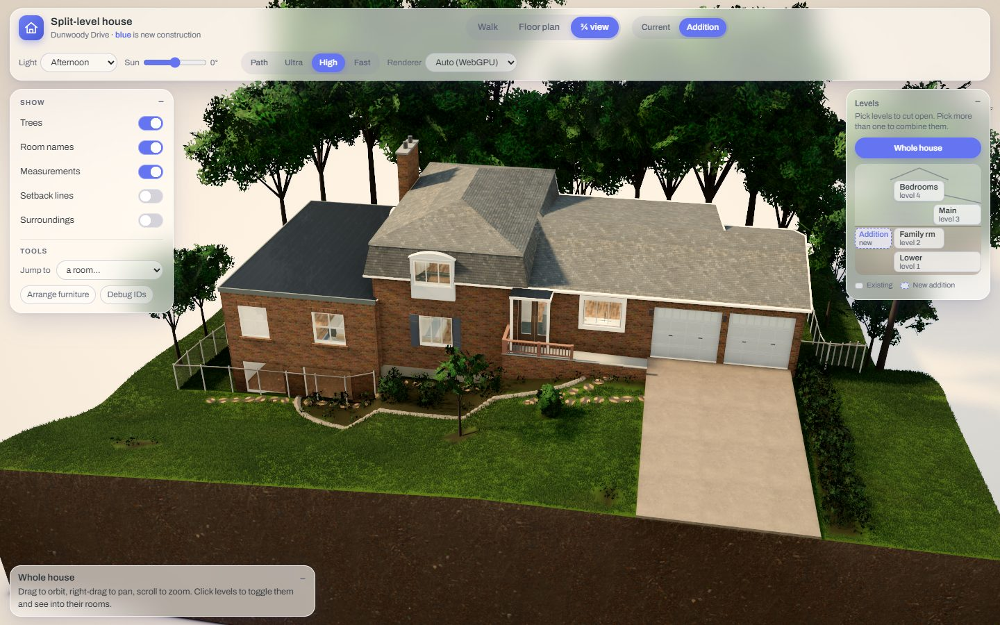
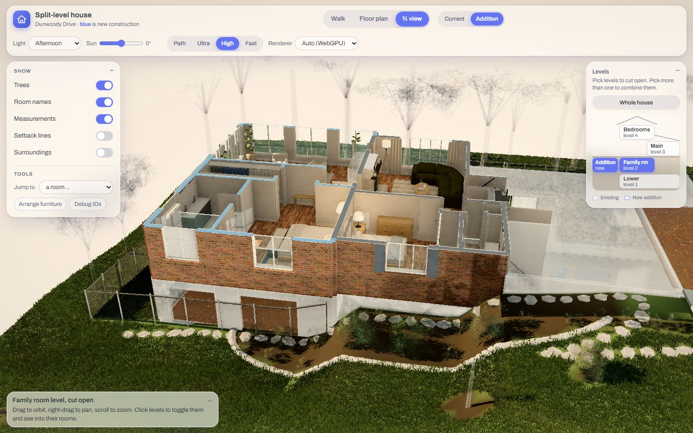
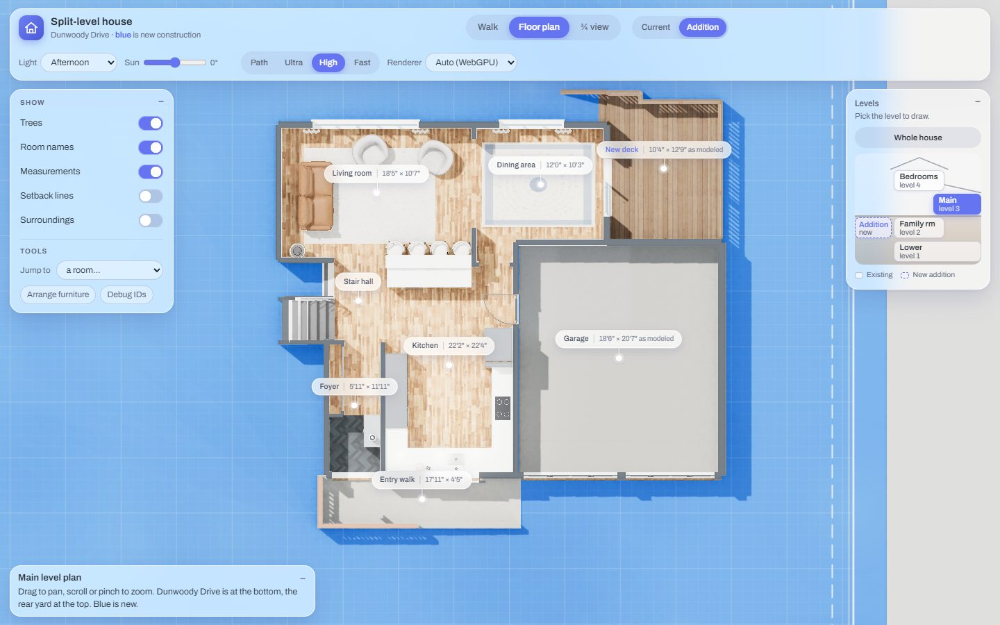
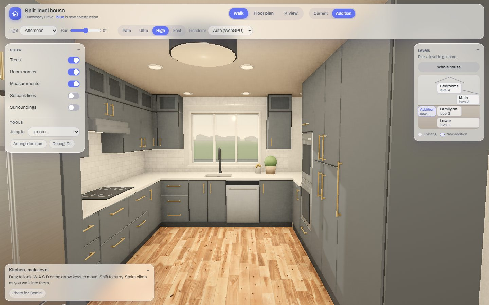
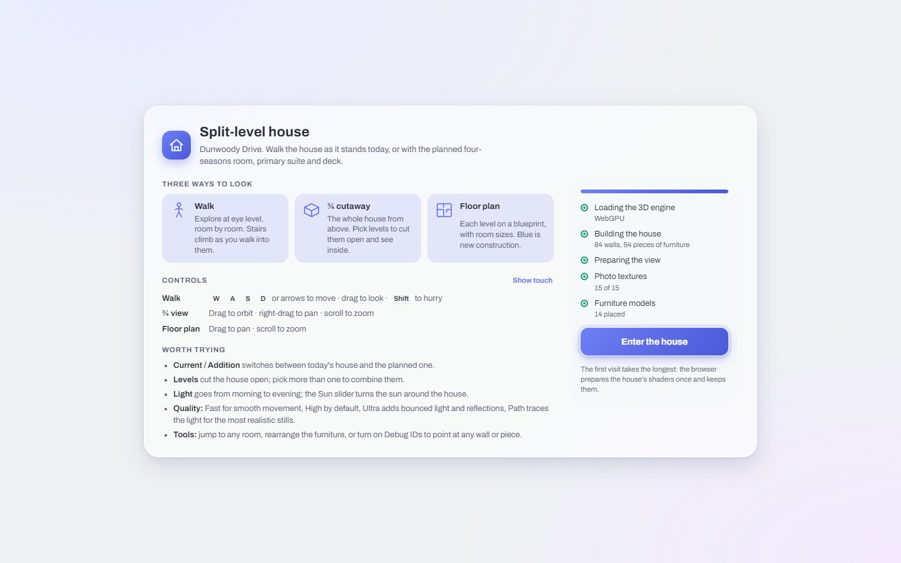
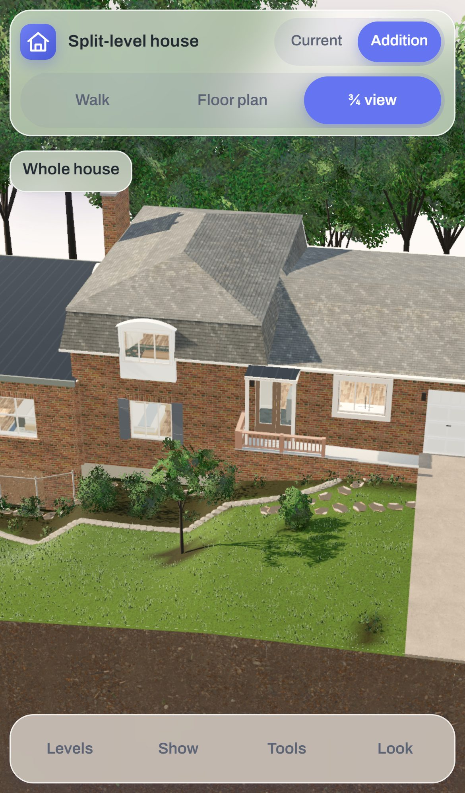
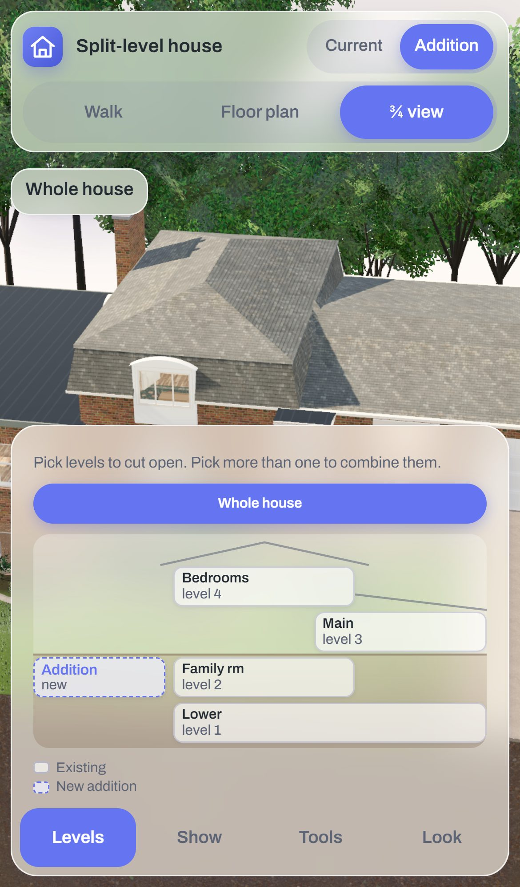

# Split-level house walkthrough

An interactive 3D model of a split-level house on Dunwoody Drive, St. Louis. It shows the house as it stands today and with two planned projects: a four-seasons room and primary suite on the west side, and a new deck off the dining room. Walk through it at eye level, cut it open level by level, read it as a floor plan, try the light at different times of day, and rearrange the furniture.

It runs in any modern browser, on desktop, iPad and phone. There is nothing to install for visitors.



| Cut open to the family room level, with the addition | Floor plan of the main level | Walking through the kitchen |
|---|---|---|
|  |  |  |

## What you can do

- **Three ways to look**
  - **Walk:** explore at eye level, room by room. Stairs climb as you walk into them.
  - **¾ cutaway:** see the whole house from above. Pick one or more levels to cut them open and see inside.
  - **Floor plan:** each level drawn on a blueprint, with room names and sizes. Blue is new construction.
- **Current and Addition:** switch between the house as it stands and the house with the planned addition and deck.
- **Light:** five presets, from morning to evening, plus a slider that turns the sun around the house.
- **Quality:**
  - **Fast:** for smooth movement.
  - **High:** the default on desktop and iPad.
  - **Ultra:** adds bounced light, reflections and soft shadows from the room lights.
  - **Path:** traces the light for the most realistic stills, on browsers with WebGPU.
- **Tools:**
  - **Jump to:** go to any room.
  - **Arrange furniture:** move and turn pieces by hand.
  - **Debug IDs:** point at any wall, window or piece of furniture and copy a reference for Claude Code.
  - **Photo for Gemini:** a fully rendered still of the current view.

The loading screen shows a getting-started guide and live progress while the house builds. **Enter the house** opens once the first view is ready.



## Controls

| View | Mouse and keyboard | Touch |
|---|---|---|
| Walk | <kbd>W</kbd> <kbd>A</kbd> <kbd>S</kbd> <kbd>D</kbd> or arrow keys to move, drag to look, <kbd>Shift</kbd> to hurry | Move pad (bottom left) to move, drag anywhere else to look |
| ¾ view | Drag to orbit, right-drag to pan, scroll to zoom | Drag to orbit, pinch to zoom, two fingers to pan |
| Floor plan | Drag to pan, scroll to zoom | Drag to pan, pinch to zoom |
| Arrange | Click a piece, drag to move, drag the ring to turn; <kbd>Q</kbd> and <kbd>E</kbd> turn 15° | Tap a piece, drag to move, drag the ring to turn |

On a phone the panels live in a bottom sheet with four tabs: **Levels**, **Show**, **Tools** and **Look** (light and quality). Tap a tab to open it and again to close it.

<p>
  
  
</p>

## Browser support

| Browser | Renderer | Notes |
|---|---|---|
| Chrome, Edge (desktop) | WebGPU | All quality modes, including Path |
| Safari 26+ (Mac, iPad, iPhone) | WebGPU | Ultra and Path need a recent iPad or Mac |
| Firefox, older browsers | WebGL | Fast, High and Ultra; Path is WebGPU only |

The app picks WebGPU when the browser offers it and falls back to WebGL otherwise. The **Renderer** menu, or `?renderer=webgl` in the address, forces one. Phones start in Fast and tablets in High; switch quality from the **Look** tab or the top bar.

## Running it locally

You need [Node.js](https://nodejs.org) 20 or newer.

```bash
npm install     # installs three.js and the test browser, and copies three's builds into vendor/ so the app works offline
npm run dev     # serves the app at http://localhost:5173 and reloads it whenever a file in src/, assets/ or index.html changes
```

### Commands

| Command | What it does |
|---|---|
| `npm run dev` | Dev server with live reload, at http://localhost:5173 |
| `npm test` | Playwright smoke tests: the scene builds, walking routes connect every level, Debug IDs map to source lines, imported models fit, the single-file build works. Takes several minutes. |
| `npm run build` | Writes `dist/house-walkthrough.html`, one self-contained file (see [Publishing](#publishing)) |
| `npm run model:check` | Checks every imported model's size and fit in the plan, and saves close-ups to `test-results/models/` |
| `npm run model:shot -- --name "<piece>"` | Renders one furniture piece alone, with its size and triangle count |
| `npm run model:textures -- <in> <out>` | Shrinks a model's embedded textures before compacting it |
| `npm run sketchfab -- search\|info\|download …` | Finds and downloads furniture models |

## Project structure

| Path | What it holds |
|---|---|
| `index.html` | Page shell, controls, loading screen and the script list |
| `src/` | The app, as plain scripts sharing one scope, split by system: layout data (`02-spec.js`), materials (`03`/`04`), geometry (`05`), house (`06`), furniture (`07`), site (`08`), rendering (`08b`, `08c`, `09`), Debug IDs (`10`), Arrange (`11`), app shell (`12`), imported models (`13`), photo export (`14`), path tracing (`15`) |
| `assets/models/` | Imported furniture models and their manifest ([README](assets/models/README.md)) |
| `assets/textures/` | Photo textures and their manifest ([README](assets/textures/README.md)) |
| `assets/reference/` | Floor plans, concept plans and photos the model is based on |
| `docs/` | Working notes: [handoff context](docs/CONTEXT.md), [adding content](docs/adding-content.md), [modelling notes](docs/model-notes.md), [WebGPU migration log](docs/webgpu-migration-plan.md) |
| `scripts/` | Dev server, single-file build, three.js vendoring, model tools |
| `tests/` | Playwright smoke tests |
| `dist/` | The single-file build |

[`CLAUDE.md`](CLAUDE.md) explains the architecture in depth: units and axes, how walls are described, tags and visibility, the two house states and the rendering pipeline. Read it before larger changes.

## Working with Claude Code

Open the folder in VS Code and start Claude Code. It reads `CLAUDE.md` and `docs/CONTEXT.md` automatically.

- **Point at things with Debug IDs.** Turn on Debug IDs, tap a wall, window, floor or piece of furniture, press **Copy for Claude**, and paste it into your request. Claude Code goes straight to the line that builds it.
- **Rearrange, then save.** Move furniture in Arrange mode, then press **Save to code** (on the dev server) or **Copy all moves** and ask Claude Code to make them permanent.
- **Import real furniture.** Ask for a product by name; the `import-model` skill finds, sizes and places a model and checks that it fits.

## Publishing

`npm run build` writes `dist/house-walkthrough.html`, a single file you can open directly or upload to a Claude chat to publish as an artifact. It embeds the code and the imported models. The photo textures stay out of it, so the published page shows the generated textures instead.

A published artifact must stay under 16 MB. The build is about 7 MB, most of it the compacted furniture models; compact any new model before adding it (see [assets/models/README.md](assets/models/README.md)).

## Troubleshooting

- **The first load is slow.** The browser prepares the house's shaders on the first visit and keeps them, so later visits are faster. The loading screen shows each stage as it happens.
- **The view is blank or the app reports it could not start.** Switch the **Renderer** to WebGL, or add `?renderer=webgl` to the address, and reload.
- **Ultra or Path is slow on a tablet.** They are designed for desktop GPUs. Use High on iPad and Fast on a phone.
- **Furniture is in the wrong place after an update.** Moves made in Arrange mode are kept in your browser. Press **Reset all** in Arrange mode to see the saved layout.

## Credits

- **3D engine:** [three.js](https://threejs.org) r186 (MIT). Path tracing uses [three-gpu-pathtracer](https://github.com/gkjohnson/three-gpu-pathtracer) (MIT); denoising uses [Open Image Denoise](https://www.openimagedenoise.org) through oidn-web (Apache 2.0).
- **Photo textures:** [Poly Haven](https://polyhaven.com) (CC0). Brick 4 and Roof Slates 03 by Rob Tuytel; Wooden Floor 02, Wooden Planks, Gravel Concrete and Forest Ground 06 by Charlotte Baglioni and others; Laminate Floor by Dimitrios Savva and Dario Barresi; Curly Teddy Natural by colormass. Full credits are in [`assets/textures/manifest.json`](assets/textures/manifest.json).
- **Furniture models:** supplied by the owner (see [`assets/models/manifest.json`](assets/models/manifest.json)). Models downloaded from Sketchfab record their author and licence there. Product names are used only to describe the pieces modelled.
- **Rug patterns:** photos supplied by the owner.
- **Font:** [Archivo](https://fonts.google.com/specimen/Archivo) (SIL Open Font License).
